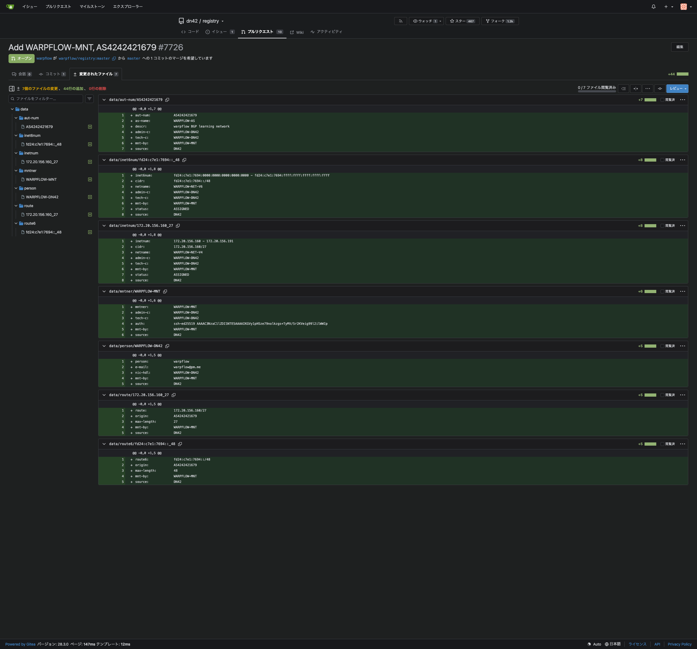
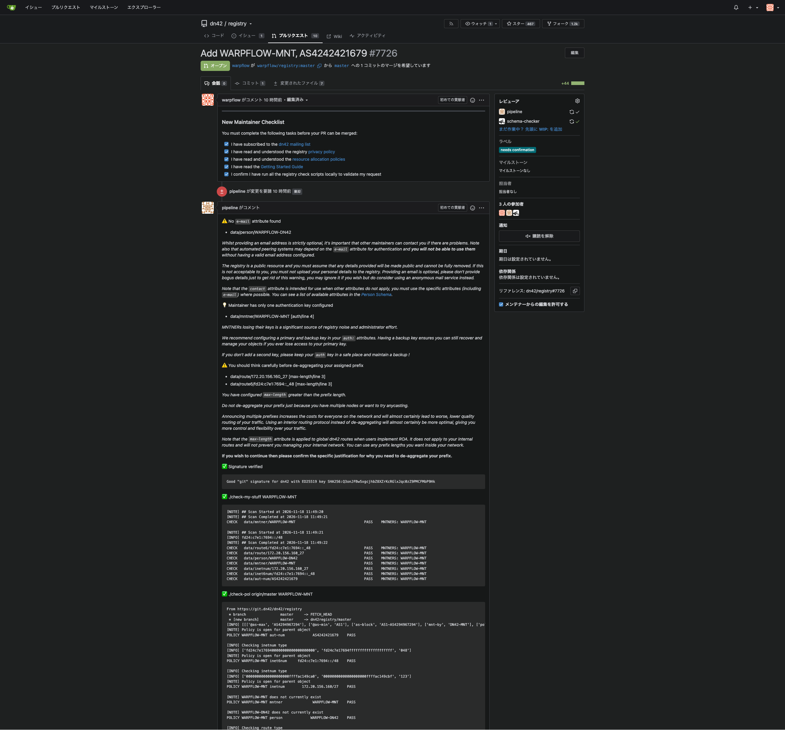
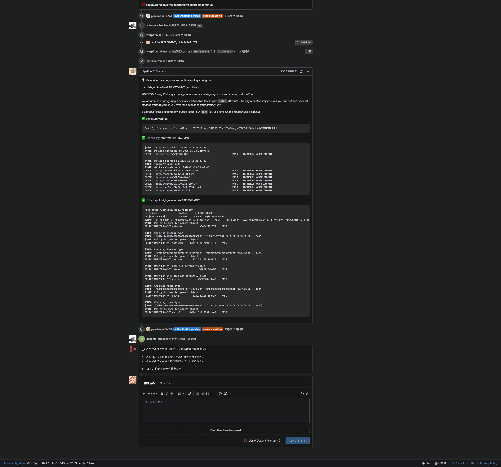
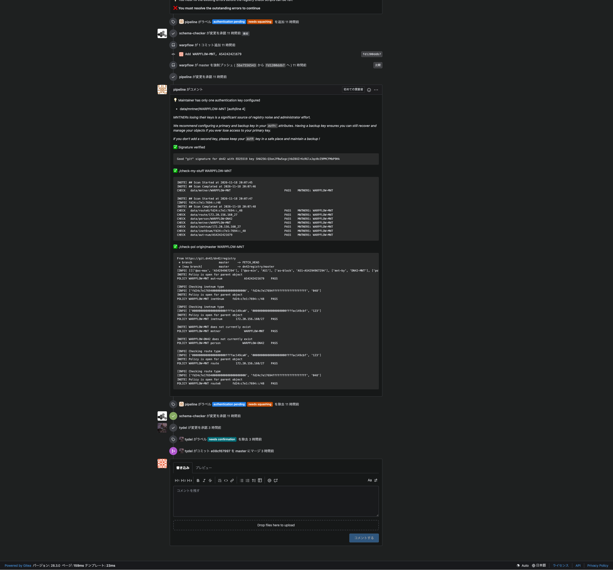
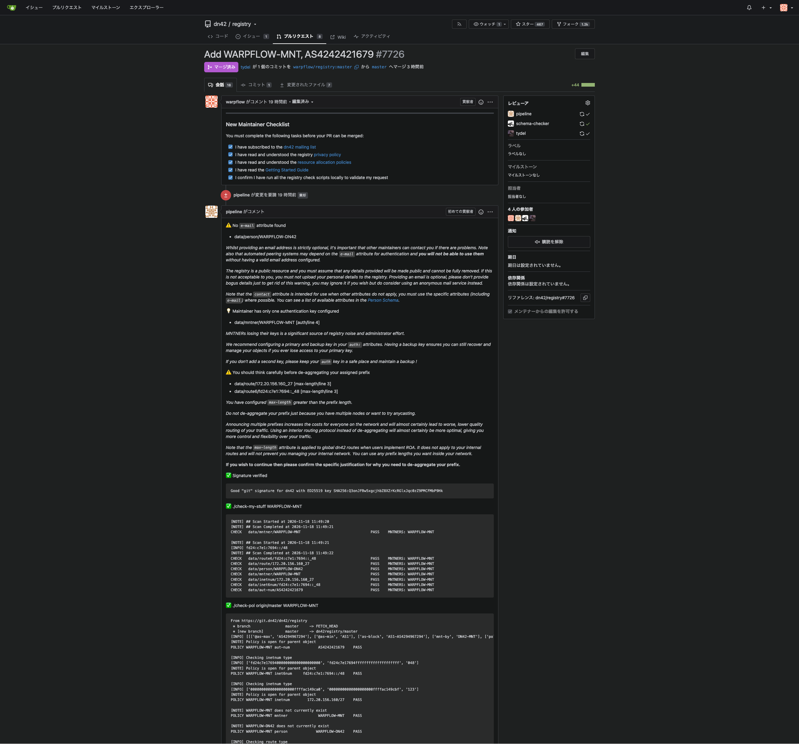

# はじめに

<!-- TODO: DN42を始めたきっかけ・この記事で書くこと -->

# DN42とは

<!-- TODO: DN42の概要（BGPで相互接続する分散型の実験ネットワーク、ASN 4242420000-4242423999 / 172.20.0.0/14 / fd00::/8 など） -->

# 今回取得したリソース

| 種類 | 値 |
| --- | --- |
| AS番号 | AS4242421679 |
| IPv4 | 172.20.156.160/27 |
| IPv6 | fd24:c7e1:7694::/48 |
| MNTNER | WARPFLOW-MNT |
| person | WARPFLOW-DN42 |

# 登録手順

## 1. 事前準備

<!-- TODO: git.dn42.dev のアカウント作成、メーリングリスト購読、SSH鍵（ED25519）の用意など -->

## 2. registryをforkしてオブジェクトを作成

registry に以下の7ファイルを追加しました。

- `data/mntner/WARPFLOW-MNT`
- `data/person/WARPFLOW-DN42`
- `data/aut-num/AS4242421679`
- `data/inetnum/172.20.156.160_27`
- `data/inet6num/fd24:c7e1:7694::_48`
- `data/route/172.20.156.160_27`
- `data/route6/fd24:c7e1:7694::_48`

<!-- TODO: 空いているアドレス・ASNの探し方、各オブジェクトの説明 -->

## 3. チェックスクリプトを実行してPRを出す

<!-- TODO: ./check-my-stuff / ./check-pol の実行、コミットのsquash、署名（./sign-my-commit）について -->

## 4. pipelineに怒られる

PRを出すと pipeline が自動でチェックしてくれます。最初のPRでは以下の指摘を受けました。

- `e-mail` 属性がない
- `max-length` がプレフィックス長より大きい（de-aggregate しないなら合わせる）
- 認証鍵が1つしかない（バックアップ鍵の推奨）

<!-- TODO: どう直したか -->

## 5. 修正して force push

<!-- TODO: 修正内容、ラベル（authentication pending / needs squashing）が外れるまでの流れ -->

## 6. マージされた！

レビュアーの方に承認してもらい、無事マージされました。

# ピアリングしてみた

<!-- TODO: 使った環境（VPS / OS）、トンネル（WireGuard など）、BGPデーモン（BIRD など）の設定、ピア先の探し方 -->

# 運用してみて

<!-- TODO: 経路が見えた瞬間、ハマったところ、学んだこと -->

# まとめ

<!-- TODO -->

# 参考文献

- [dn42 Getting Started](https://dn42.dev/howto/Getting-Started)
- [dn42/registry](https://git.dn42.dev/dn42/registry)
- [dn42/registry PR #7726](https://git.dn42.dev/dn42/registry/pulls/7726)
